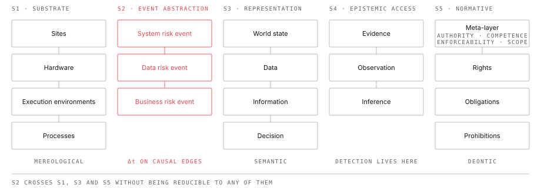

# Layered Event Modelling: Semantic Separation as a Precondition for Explicit Causal Analysis

**Author:** Bernhard Kreinz (ORCID [0009-0005-2148-9903](https://orcid.org/0009-0005-2148-9903))
**Version:** 1.0
**Date:** 2026-10-15
**License:** CC BY 4.0
**Status:** Working version — not deposited.
**Instantiation:** TLCTC framework specification v2.7 (canonical dictionary `json-schemas/layer-1/tlctc-framework.v2.7.json`); TLCTC definitions are quoted from it verbatim.

**Keywords:** levels of abstraction; causal modelling; ontology; operational risk; compliance risk; normative structure; deontic logic; bow-tie; transition duration (Δt); semantic precision; event layering

---

## Abstract

Modelling in applied risk and safety disciplines is limited less by the availability of data than by the semantic condition of the vocabulary used. Where a single predicate — *integrity*, *failure*, *compromise*, *availability* — is applied across physical assemblies, executing systems, representations and organisational outcomes, the model cannot support explicit causal analysis: the predicate silently changes its truth conditions as the analysis crosses abstraction boundaries, and the crossing itself becomes invisible.

The central claim is narrower and, we argue, more defensible than a general thesis about causal reasoning: **semantic continuity across an abstraction boundary conceals the mechanism by which the boundary is crossed.** Causal inference remains possible with ambiguous vocabulary; what becomes impossible is an explicit, testable model of the transition.

Four contributions follow. First, we separate the framework's object language from its metalanguage, so that semantic separation constrains domain predicates without prohibiting the shared formal vocabulary any model requires. Second, we distinguish five structures routinely fused into a single "layer stack": a substrate hierarchy, an event-abstraction hierarchy, a representation hierarchy, an epistemic access structure, and a normative structure of rights, obligations and prohibitions. Third, we propose a taxonomy of six edge types for token-level event structure — causal, constitutive, classificatory, normative, representational and evidential — kept apart from a type-level stratum of architectural dependencies and the normative meta-layer, and argue that a transition duration Δt is defined only for causal edges. Fourth, we give operational diagnostics for predicates and for edges, so that the proposal is falsifiable rather than hortatory.

Cyber, operational and compliance risk are the primary instantiations, and the cause-oriented Top Level Cyber Threat Clusters (TLCTC) framework serves as the worked instantiation throughout. Generality beyond them is treated as a hypothesis, not a result.

In bow-tie terms, the framework gives the consequence side — the passage from system risk events through data risk events to business risk events — the discipline a cause-based taxonomy already gives the cause side. Its most consequential practical claim is that a transition duration, and with it the intervention window available to detective, response and circuit-breaker controls, exists only on causal edges, and is undefined rather than zero on constitutive, classificatory and normative ones.

---

## 1. Introduction

Applied modelling disciplines converge on a common shape. A physical substrate is described; systems acting on that substrate are described; representations produced by those systems are described; decisions consuming those representations are described; and the norms against which all of these are judged are described.

These descriptions routinely share vocabulary. The same predicate is applied at every stage. In technical communication this is efficient, because a competent reader supplies the missing disambiguation from context. In formal modelling it is destructive, for two reasons.

The first is familiar. A predicate whose truth conditions vary by layer cannot appear in a consistent state space. If *integrity* denotes absence of unauthorised modification when predicated of a record, and conformance to an authorised specification when predicated of a system, then "integrity was lost" does not identify a state, and transitions into and out of that state cannot be modelled.

The second is the substantive claim of this paper. When the vocabulary is continuous across a boundary, the analyst does not notice that a boundary has been crossed, and therefore does not ask what mechanism carried the effect across it. The transition — normally the object of genuine explanatory interest — disappears into a shared word. The argument runs:

1. Different kinds of object require different predicates.
2. Reusing a predicate across kinds can conceal a change in truth conditions.
3. A concealed change in truth conditions conceals the boundary crossing.
4. A concealed crossing cannot be modelled, measured or controlled.

Note the scope. We do not claim that causal inference requires a fully disambiguated vocabulary; practitioners reason causally with ordinary language routinely and often correctly. We claim that the resulting causal model is *under-specified* — that the crossing points at which controls act, latencies accrue and interventions are possible cannot be located. Semantic separation is a precondition for explicit and testable cross-layer causal analysis, not for causal thought.

---

## 2. Object language and metalanguage

A framework that requires one meaning per term must first exempt its own vocabulary, or it is self-refuting.

Terms such as *event*, *state*, *node*, *edge*, *cause*, *duration*, *intervention* and *identity* necessarily operate across all layers. They are not domain predicates; they belong to the metalanguage in which layers are described. Their reuse is legitimate precisely because their definitions are layer-invariant.

We therefore distinguish:

- **Domain predicates**, whose truth conditions are stated relative to a layer's ontology, and which are the object of the separation requirement;
- **Metalanguage terms**, which are shared, and whose definitions must be invariant across every layer in which they appear.

The test for membership is whether the term's argument structure and truth conditions change when the layer changes. *Compromised* fails this test and is a domain predicate. *Edge* does not and is metalanguage. The distinction is the classical one between object language and metalanguage (§3.1), applied here to a modelling vocabulary rather than to a formal language.

This distinction also disposes of an apparent paradox: the framework may legitimately speak of "events at every layer" while forbidding any single event predicate from spanning layers.

---

## 3. Related work

Marr's division of computational, algorithmic and implementational levels [1] established that explanatory questions posed at one level are not answered by descriptions at another. Floridi's *method of levels of abstraction* [2] is the closest antecedent: a level is defined by typed observables, and claims are held to be meaningless until the level at which they are made is declared. Floridi relates the levels of a gradient of abstraction through relations between their observables, but these are relations between descriptions of one system, not occurrences in it; the method has no place for the question whether anything happens, or how long it takes, in passing from one level to the next. The present framework adds three things: a typing of inter-level relations by which a causal transition with Δt > 0 is told apart from a synchronous constitutive or classificatory one (§6); the separation of one family of levels into five structures (§4); and a diagnostic procedure (§§7–8).

In safety and risk engineering, Rasmussen [3] models socio-technical systems as levels with materially different time constants, locating accidents in loss of control across boundaries. Leveson's STAMP [4,5] develops this into hierarchical control, with accidents resulting from inadequate constraint enforcement between levels. Both anticipate the emphasis on transitions; neither imposes a semantic separation requirement on the vocabulary.

The test of §2 makes the difference precise. STAMP's failure vocabulary — inadequate control actions, inadequate enforcement of constraints, missing or inadequate feedback — is applied at every level of the control structure, from the physical process to the legislature. Its argument structure (a controller, a controlled process, a constraint) does not change from level to level, so by the test of §2 it is legitimate metalanguage rather than an overloaded domain predicate. That is its strength and the limit of the comparison. A layer-invariant failure term cannot name the layer-specific state a crossing produces: it locates *where* control was inadequate without distinguishing a system that has left its owner's control from a record that no longer corresponds to its referent. The two proposals are therefore complementary: STAMP supplies a control vocabulary, this paper a constraint on the domain predicates beneath it.

The metaphysics of levels supplies two cautions. Craver and Bechtel [6] distinguish inter-level constitutive relations from intra-level causal relations, and analyse apparent top-down causation as constitution plus same-level causation. Their analysis is stated for levels of mechanisms, which are ordered by part and whole: a lower-level entity is a component of a higher-level one, and a whole cannot be the effect of its own parts. For S1, which is mereological (§4), the analysis is accepted here without reservation. It does not transfer to S2. A data risk event is not a component of a business risk event: a false payment instruction and the transfer it later triggers are distinct occurrents, and the second can be prevented after the first has occurred. That is why §4 can accept the analysis for the substrate and still admit vertical causal edges, with Δt > 0 and an intervention window, between event layers. Hoel, Albantakis and Tononi [7] argue that macro-level descriptions can carry greater causal power than the micro-levels realising them, so any claim that higher layers are derivative must be argued rather than assumed.

The framework presupposes formal ontology discipline in Guarino's sense [8]; its causal edges are intended to be compatible with the interventionist account [9]; its representation relations draw on Dretske [10]. The conjecture in Note N6 concerns identifiability in the sense familiar from causal inference [11].

Guarino's programme has been carried furthest in the Unified Foundational Ontology (UFO). Its ontology of events, UFO-B [12], separates objects, events and situations, and the Common Ontology of Value and Risk (COVER) [13] builds on it an account of risk in which a risk experience is composed of threat events and loss events, with likelihoods attached both to triggering and to causation. This is the nearest formal-ontology treatment of the subject, and its distinction between objects, events and situations is presupposed here. On our reading it does not make the three separations this paper turns on. Its risk events are divided into cause and loss, not into a hierarchy of events individuated under different descriptions (S2); the representations such events concern do not form a structure of their own (S3); and the observation of an event is not separated from the event (S4), so detection has no place of its own. Whether S2–S4 can be stated as an extension of COVER rather than as an alternative to it is left open (§13.9).

### 3.1 Position

What this paper proposes is not new in any one of its elements but in their combination, and in the constraint the combination imposes. We are not aware of a model in risk, safety or security engineering that does all four of the following: (a) binds domain predicates to a declared layer while exempting a layer-invariant metalanguage (§2, A2); (b) separates substrate, event abstraction, representation, epistemic access and normative standing as distinct structures (§4); (c) types the relations between levels so that a transition duration is defined only on causal edges (§6); and (d) supplies diagnostics by which a violation of each can be shown (§§7–8).

Each element has antecedents: (a) in the distinction between object language and metalanguage due to Tarski [14] and Carnap [15]; (b) in part in Marr, Floridi, and Craver and Bechtel, and for normative standing in Hohfeld and in deontic logic (§3.2); (c) in the interventionist account [9] and in Rasmussen's attention to time constants. The claim of novelty is therefore a claim about synthesis, limited to the literature cited here; §12 records it as such.

### 3.2 Normative standing

The fifth structure of §4 draws on two traditions. Hohfeld [17] analysed jural relations into eight positions in correlative and opposite pairs: right and duty, privilege and no-right, power and liability, immunity and disability. Deontic logic in the tradition of von Wright [18] treats obligation, permission and prohibition as interdefinable: what is forbidden is what it is obligatory not to do.

The normative structure adopted here [19] uses three object-level elements — rights, obligations and prohibitions — and a meta-layer of authority, competence, enforceability and scope. It does not claim that the three are logically irreducible; the source says as much, and claims operational usefulness rather than originality. §4 states why prohibition is nonetheless kept as a type of its own.

### 3.3 Applied frameworks in cyber and operational risk

Applied frameworks in cyber and operational risk each capture part of the causal structure. Read with the diagnostics of §§7–8, each also fuses two of the structures of §4, or the two sides of the bow-tie, at a characteristic point. The table records where, on our reading. It assesses the frameworks as risk-modelling vocabularies, not their usefulness for the purposes they were built for.

| Framework | What it captures | Where it fuses structures (on our reading) |
|---|---|---|
| **FAIR** [20] | Separates threat events from loss events; decomposes loss event frequency and loss magnitude quantitatively. | Quantifies the passage from threat to loss without typing either side. There is no taxonomy of causes, and the forms of loss (productivity, response, replacement, fines and judgments, competitive advantage, reputation) are business-level; the system and data events between threat and loss are not modelled as events of their own. |
| **VERIS** [21] | Records incidents in the A4 model: actor, action, asset, attribute. | Action categories (malware, hacking, social, misuse, physical, error, environmental) are compiled from incident practice: one names a mechanism, another a channel or skill, another the actor's standing, so one step can fall under several. Attributes (confidentiality, integrity, availability, with their pairs) are predicated of assets of every kind, from servers to people — the P1 pattern of §10. |
| **STRIDE** [22] | A six-letter design prompt for threat modelling. | Three letters name outcomes on the data (information disclosure, tampering, denial of service), two name states reached through a step (spoofing, elevation of privilege), and one names a missing control (repudiation). None names a generic vulnerability, so cause and consequence share one list. |
| **Basel loss-event types** [23] | Standardise operational loss reporting in seven level-1 event types. | Actor and intent (internal fraud, external fraud), the affected object (damage to physical assets) and the consequence (business disruption and system failures) stand side by side as peers [19]. The ORX reference taxonomy [24] replaces them for many firms and adds a separate cause and impact taxonomy — a step toward the separation argued for here. |
| **MITRE ATT&CK** [25] | Catalogues observed adversary tactics and techniques in operational detail. | Tactics name goals, techniques name means, and one technique can serve several tactics. A single technique can also span more than one cause — creating a scheduled task both uses an intended function and executes foreign code — so goal, mechanism and cause share one matrix. |
| **STAMP / STPA-Sec** [5, 26] | Treats losses as the result of inadequate enforcement of constraints in a hierarchical control structure. | Its failure vocabulary is layer-invariant metalanguage (§3): it locates where control was inadequate but does not name the layer-specific state a crossing produces, and it supplies no taxonomy of causes. |
| **ODC** [27] | Classifies software defects along orthogonal attributes (defect type, trigger, impact). | Orthogonality is achieved within software defects found during development. Causes outside software — human, physical, third-party — and the event layers after deployment are out of scope. |
| **Causal Bayesian networks** [11] | Compute intervention effects along attack graphs with directed acyclic graphs and the do-calculus. | The formalism is sound, but nodes are typically labelled with techniques, vulnerabilities or an untyped "compromise", without layer typing: exact mathematics over a vocabulary the predicate diagnostics of §7 would flag. |

Two readings follow, stated as readings rather than results. On the cause side, catalogues built by observation grow with every new technique and never close; a taxonomy derived from generic vulnerabilities, with completeness held as a falsifiable hypothesis — such as the Top Level Cyber Threat Clusters [28] — is a different kind of object. On the consequence side, frameworks that quantify or report loss rarely type the events between the central event and the loss. That is the gap §§4–10 address.

---

## 4. Five structures, not one stack

Layered models in this area typically fuse several structurally different hierarchies into a single ladder. Separating them is a precondition for applying the framework to itself.

**S1 — Substrate (containment) hierarchy.** Orders entities by physical, organisational and computational locality: sites contain hardware; hardware hosts execution environments; environments run processes; organisations control personnel and third parties. Its relations are mereological and custodial. Effects propagate along it by physical and computational mechanism.

**S2 — Event-abstraction hierarchy.** Orders *events* by the description under which they are individuated. In the instantiation used throughout this paper, the TLCTC framework [28], it has three levels: system risk events (SRE), data risk events (DRE) and business risk events (BRE), linked in the consequence chain SRE → DRE → BRE*. Further levels are possible; §12 names the candidates. This is the operative structure for risk modelling, and it is *not* identical to S1.

**S3 — Representation hierarchy.** Orders descriptions by their relation to what they describe: a world state is recorded as data; data are interpreted as information under a schema and purpose; information supports a decision. Its relations are semantic. A representation can misrepresent, which has no analogue in S1 — a server cannot be *wrong about* a rack.

**S4 — Epistemic access structure.** Orders evidence, observation and inference. It describes the analyst's or the monitoring system's access to the modelled system, not the system itself. Detection lives here.

**S5 — Normative structure.** Orders the standing of states and events against norms: legal, regulatory and contractual requirements and an organisation's own policies [19]. At object level it has three elements: rights, obligations and prohibitions. Above them sits a meta-layer of authority, competence, enforceability and scope, which decides whether a norm applies to a case at all. Within an organisation, norms accumulate in shells — legal form, then sector and activity, then process and product — multiply across jurisdictions, and change over time through amendment. Its relations are deontic. Nothing in S1–S4 is compliant or non-compliant; compliance is a relation between an occurrent in those structures and a norm in S5.

Prohibition is kept as a type of its own, although deontic logic can define it as an obligation to omit (§3.2). The reason is diagnostic, not logical. With two types, the type of a norm no longer tells an analyst what an omission means: under an obligation to act, doing nothing is a violation; under an obligation to omit, it is fulfilment, and only the content of the norm says which. With three types, the type alone settles how an omission is evaluated, which is what P4 (§7) asks of a state space. The choice is a modelling convention adopted for that property; it costs no expressive power and could be revised.

*Figure 1 — The five structures are drawn side by side rather than stacked, because they are not levels of one ladder. S2 — the operative structure for risk modelling — is marked as focal: the transition durations that bound intervention windows are measured along it. S5 has no internal ordering among its three elements; the meta-layer above them decides whether a norm applies.*

The critical point is that S2 crosses S1, S3 and S5 without being reducible to any of them. A system risk event is individuated by a change in system state; a data risk event by a change in a representation's standing; the malware that alters a payment-generation process sits in S1, the false instruction it emits sits in S3, and both are events in S2. A compliance event is individuated by a divergence between an occurrent in S1–S3 and a requirement in S5; where it is recorded as a business risk event, the edge that makes it one is normative, not causal (§6).

**Vertical edges in S2 are frequently genuinely causal.** Consider: malware modifies a payment-generation process (SRE); false payment instructions are generated (DRE); funds are transferred and loss crystallises (BRE). Time elapses at each step. Payment screening can intervene between the second and third. Settlement finality bounds the intervention window. These are three distinct events with measurable Δt between them, not three descriptions of one synchronous situation.

It is tempting to treat vertical relations in S2 as predominantly constitutive. That conflates S2 with S1: it applies the mechanistic picture of levels (§3), which is correct for the substrate, to a structure that is not mereological. The correct position is that **edge type is determined per edge, by the diagnostics of §8, and not by which pair of layers the edge connects.** Some S2 vertical edges are causal; some are constitutive; some, as §6 argues, are classificatory; and some, where S5 is involved, are normative. The framework's value lies in forcing that determination to be made explicitly.

---

## 5. Axioms

The following are methodological stipulations adopted for their consequences. They are not theorems, and nothing below is proven.

**A1 — Node typing.** Every model node representing a domain event, state, entity or norm is assigned to exactly one layer of exactly one structure.

**A2 — Predicate locality.** Every domain predicate has one explicit definition and a declared layer of application. A predicate may be reused across layers only where its truth conditions and argument structure are demonstrably invariant; otherwise it is decomposed into layer-specific predicates.

**A3 — Explicit cross-layer identity.** No model node is assigned to more than one layer. Where several layer-specific nodes refer to the same real-world object or situation, that co-reference is declared as an explicit identity relation.

**A4 — Edge typing.** Every edge carries a declared type. The type determines which properties, including duration, are defined for that edge.

**A5 — Directional openness.** Layer ordering is an ordering of abstraction, not of causation. Causal edges may run in either direction.

**A6 — Stratum separation.** Type-level structure (architectural dependencies, constraints, service definitions, and the normative meta-layer of authority, competence, enforceability and scope) and token-level structure (occurrent events and states, and their standing as fulfilment or violation of a norm) are modelled separately and related explicitly.

A3 replaces a stronger and metaphysically awkward claim that no entity exists at two layers. A payment is legitimately an executing process, a data record, a business transaction and a regulatory reportable item. The framework does not deny this; it requires that the four model nodes be distinct and their co-reference declared, so that a claim about one is not silently transferred to another.

A5 corrects the tempting error of treating a stack as a fixed propagation sequence. Industrial sabotage in which falsified process values drive destructive actuator behaviour runs from representation to physical outcome; organisational decisions propagate downward into system configuration. A framework that fixes vertical direction is refuted by its own primary application domain.

---

## 6. Edge taxonomy

Edges are typed by what would have to be true for the edge to fail.

**Causal.** One event brings about, or raises the probability of, another under intervention. Causal edges have a well-defined Δt, may fail to fire, and may be interrupted. Both intra-layer chains and genuine cross-layer propagation are of this type.

**Constitutive.** One state realises or partly constitutes another at a higher level of description. The relation is synchronous: no time elapses, nothing propagates, and the higher-level state cannot be prevented once the constituting states obtain. Example: given a declared reconciliation scope, the firm's *unreconciled position* is constituted by the standing of the relevant records at a time. It is not a later effect of those records; it is what those records amount to.

**Classificatory.** An event, state or object satisfies the criteria of a category under a declared classification scheme. Failure conditions are distinctive: criteria not met, scheme changed, event misinterpreted, evidence incomplete. This type is neither causal nor constitutive, and it is where regulatory loss-event categorisation belongs.

Threshold definitions are classificatory, not constitutive: "more than 5% failed instructions in fifteen minutes constitutes a service degradation event" applies a rule that could have been drawn otherwise. Its truth depends on a scheme, not on the world alone. Distinguishing this case from genuine constitution is one of the taxonomy's more useful discriminations.

**Normative.** An occurrent — an act, an omission, a state — stands as fulfilment or violation of a norm in S5, under a meta-layer that makes the norm applicable: an authority with competence, an enforceable rule, a scope that reaches the case. Failure conditions are again distinctive: the norm is amended or repealed, its scope does not reach the case, the authority lacks competence, or the evidence does not establish the occurrent. The normative edge differs from the classificatory one in what changes when the scheme changes. Reclassifying under a revised threshold changes what an event is counted as. Amending a norm changes what an organisation is required to do, and can turn an unchanged process from compliant to non-compliant without anything happening in S1–S3.

**Representational.** A representation stands in correspondence to a referent. Failure is misrepresentation, not non-occurrence, and is evaluated by comparison rather than temporal succession.

**Evidential.** An observation supports an inference about a state. These belong to S4, run from world to observer, and describe access to the model rather than mechanism within it. Treating an evidential edge as causal is a recurrent error in incident reconstruction.

**Δt is defined only for causal edges.** This is not a further stipulation; it follows from what a path is. A risk path is a chain of events, and only causal connection makes a chain: where one event does not bring about another, the two are not successive links, and there is no transition whose duration could be measured. Attaching a duration to a constitutive, classificatory or normative relation therefore asserts a propagation delay where no propagation occurs. Where an analysis appears to need one, the interval being measured is normally a separate causal process — typically detection and response latency, which is an S4 phenomenon with its own edges.

Deadlines are the instructive case. A statutory notification window — 72 hours under Article 33 GDPR [29] — looks like a Δt on a normative edge. It is not. The norm sets a bound on a separate response process, and the clock starts when the controller becomes aware of the breach, an S4 event, not when the breach occurs. The interval that matters is causal and runs from awareness to notification; the norm fixes how long it may be, and the violation edge holds or not depending on how long it was. The normative edge itself has no duration. In the TLCTC instantiation a business risk event is defined accordingly: "A discrete business-level event on the consequence side, reached from a Data Risk Event or a preceding Business Risk Event by a causal edge (it is brought about, after a Δt) or by a normative edge (a duty arises or a norm is violated, with no Δt of its own). BREs may chain; an organization's risk appetite designates the terminal BRE as its Business Impact, a role a BRE can hold rather than a separate event type." [28] The notification duty is such an event, reached by a normative edge; the filing of the notification is a separate causal act, and only the second carries a Δt.

### 6.1 The dependency stratum

Architectural relations such as "payment execution requires a readable account record" are not token edges in an event graph. They are type-level constraints that hold before, during and after any event, and they license the causal edges that may occur. Modelling them as a further edge type in the same graph would repeat the fusion error the framework exists to prevent.

Per A6, dependency, prerequisite and constraint relations therefore form a separate type-level stratum. Its practical significance is considerable: many controls act on dependencies rather than on events — redundancy, fallback paths, cached values and manual alternatives all modify the dependency structure so that a given token event no longer licenses the causal edge it otherwise would.

The normative meta-layer of S5 belongs to the same stratum. That an authority holds competence over a sector, or that a rule's scope reaches an activity, holds before any event occurs and licenses which normative edges can occur at all.

---

## 7. Predicate diagnostics

A methodological proposal that cannot identify its own violations is an exhortation. The tests below apply to a candidate domain predicate T in a model M. They are intended to be applied mechanically.

**P1 — Bearer test.** Enumerate the kinds of entity to which T is predicated across M. If these fall under more than one layer's ontology, T is overloaded.

**P2 — Substitution test.** Replace each occurrence of T with its stated definition. If any sentence becomes false, ill-formed, or requires silent reinterpretation, the definition is not layer-invariant.

**P3 — Argument-structure test.** Determine T's argument places. If T is one-place in some occurrences and relational in others — *available* as a property of a record versus *available to* an agent — it is composite and requires decomposition.

**P4 — State-partition test.** Determine whether T and its declared alternatives partition the admissible state space at its layer. If they do not, T is under-specified, composite or context-dependent. §4 applies the test to S5: keeping prohibition distinct from obligation is what lets the type of a norm settle what an omission means.

A weaker test — whether the negation of T is determinate — does not suffice. Indeterminate negation is a symptom of several distinct defects — vagueness, scalarity, missing thresholds, incomplete operationalisation — and does not by itself establish a layer violation. Failure of P1 or P2 establishes overloading; failure of P3 or P4 establishes under-specification, which frequently but not invariably accompanies it.

---

## 8. Edge diagnostics

Applied to a candidate edge e between relata a and b.

**E1 — Temporal separation.** Is a non-zero interval between a and b coherent? If not, e is constitutive, classificatory or normative, and causal language is illicit.

**E2 — Intervention.** Is there an intervention that breaks e without altering the identity of either relatum [9]? If not, e is not causal.

**E3 — Identity preservation.** Do a and b remain distinct occurrents, or is b a redescription of a? Redescription indicates constitution or classification.

**E4 — Scheme dependence.** Would e cease to hold if a declared classification scheme, service definition or threshold were altered, with the world unchanged? If so, e is classificatory — or normative, where the altered scheme is a norm in S5 (a statute, a regulation, a contract, a policy) rather than a counting or reporting scheme.

E1 and E2 separate causal from non-causal; E3 and E4 separate constitutive from classificatory and normative, and the kind of scheme named in E4 separates the last two.

A test case shows the procedure where intuition is unreliable. A rack loses power and the systems on it go down. Between the loss of power and the halting of the hosts, E1 finds an interval, however short, and E2 finds interventions that break the edge without altering either relatum: with an uninterruptible supply or a second feed, the rack's supply is still lost but the hosts keep running. That edge is causal and carries a Δt. Between the halting of the hosts and the outage of a service declared to run on exactly those hosts, E1 finds no coherent interval and E3 finds a redescription: given the declared service topology, the outage is what the halted hosts amount to. E4 does not fire, because the topology is not a counting rule: it records where the service actually runs, so altering the declaration with the world unchanged would make it false rather than change what the hosts amount to — the same role the declared reconciliation scope plays in §6. That edge is constitutive. Had the outage been declared by a criterion — a share of failed requests over a window — E4 would make it classificatory. One incident thus carries three edge types, and the diagnostics assign them edge by edge once the relata are declared. Note N3 records the harder case, in which a single occurrence under two admissible descriptions receives two different types.

---

## 9. State spaces

### 9.1 System compromise

A system, considered within S1 and S2, admits of a control-oriented state. A definition in terms of an actor holding a capability — whether a party without entitlement can influence system behaviour — is too narrow: it strains to cover passive compromise (credential extraction, memory disclosure, covert replication of state, observation without modification) and the exhaustion of a system's capacity by a flood.

The instantiation therefore adopts the TLCTC definition of System Compromise, which is stated around behaviour leaving owner control rather than around an actor's capability [28]:

> The behaviour, privileges, data, or trust relationships of a system — or of a communication relationship it takes part in — are brought outside what their owner controls, in service of an attacker's objective. Reached only through cluster steps (the Attack row). This is the pivot of the Cyber Bow-Tie: everything the ten clusters classify converges on it, and the interval in which compromise detection can act before any Data Risk Event, bounded by the causal Δt of that transition, exists only for this type.

By P4, the state should not be treated as binary. At least six capability dimensions can hold independently: execution control, state modification, observation without entitlement, identity or trust misuse, resource consumption, interface manipulation. They illustrate that the state is multidimensional; they are not a refinement of the TLCTC definition. No stopping rule admits them (contrast §9.3), and several track individual clusters closely — resource consumption, for instance, the flooding cluster — so codifying them as compromise types would let a consequence inherit the classification of its cause, which the framework excludes.

### 9.2 Representation states

Representation states are likewise several orthogonal dimensions, not one enumeration. They coincide with the properties on which the TLCTC dictionary defines its data risk event codes [28]; §9.3 gives the correspondence.

| Dimension | Question | Argument structure |
|---|---|---|
| Correspondence | Does the representation match its referent? | one-place, relative to referent |
| Completeness | Is the referent fully covered? | one-place, relative to scope |
| Provenance | What is the origin and transformation history? | one-place, historical |
| Attribution | Is the claimed origin the actual origin? | one-place |
| Operational presence | Does the representation exist and function in the required medium? | one-place |
| Retrievability | Can a given entitled agent obtain and use it? | relational, agent-indexed |
| Disclosure | Has a party not entitled to it obtained it? | relational, agent-indexed |

Three consequences. Attribution is independent of correspondence: a forged record may be accurate. Provenance is a factual history; whether the transformations it records were covered by an entitlement is a separate evaluation against S5, applied to that history, not part of its definition. And the final three rows are relational — they fail P3 if collapsed into a single "access" state, which is why operational presence (availability) and agent-indexed retrievability (accessibility) must remain distinct.

### 9.3 Relation to the TLCTC data risk event codes

In the TLCTC framework the dimensions are codified as data risk event codes arranged in a refinement tree [28]:

| TLCTC code | Name | Dimensions above |
|---|---|---|
| C | Loss of Confidentiality | disclosure |
| I → Ii | Incorrect state | correspondence, completeness |
| I → If | Misattributed state | provenance, attribution |
| A → Av | Unavailable state | operational presence |
| A → Ac | Inaccessible state | retrievability |

The parent codes I and A remain legal where the refinement is unknown. The framework admits these splits, and no others, by a stopping rule: a property is split only where the resulting states are distinguishable by inspecting the record itself, never by the story of how it got there. That rule is the instance of P2 and P4 for representations. It refuses a "manipulated" state, which names the actor's intent rather than a record state, and it refuses to split disclosure by cause or extent.

That the conventional *integrity* divides into two independent dimensions, and *availability* into two more, is not an artefact of the mapping. It illustrates the paper's thesis: long-standing composite terms are compressions of several orthogonal dimensions plus an implicit layer assignment.

The corresponding claim about integrity should be stated narrowly. It is not that "system integrity" is incoherent — it can be defined as conformance of actual configuration and execution to an authorised specification. It is that **the unqualified predicate *integrity* must not be reused for both systems and representations within one model**, because its truth conditions differ between them and the reuse conceals the boundary.

### 9.4 A worked case: possession

Parker's hexad adds *possession* to the classical triad because one case defeats it: a stolen copy of an encrypted backup is not disclosed, not incorrect, not gone and not unusable, so on a flat list of data properties nothing has happened [30]. The layered reading needs no sixth property. Taking the medium is an attack step that reaches the substrate physically — in TLCTC terms the physical attack cluster, whose scope includes media — and it records a system risk event: data have been brought outside what their owner controls. Whether a data risk event follows is a separate question, answered by a separate edge. With encryption at rest, the causal edge from the system risk event to a confidentiality DRE does not fire unless the key is also obtained; encryption acts as a circuit breaker on that edge (§10). The puzzle arose because a flat scheme had to file a change of custody under data, having no system level and no typed edge on which to place it.

---

## 10. Instantiation in cyber and operational risk

**Division of labour in the bow-tie.** A bow-tie places a central event between its causes and its consequences. A cause-based cluster taxonomy disciplines the left side: it names the generic vulnerability exercised at each step that leads to the central event. The present framework disciplines the right side — the propagation from a system risk event through data risk events to business risk events. The two sides need different instruments. On the left the characteristic error is a misnamed cause, and the remedy is a partition of causes. On the right it is an untyped crossing, and the remedy is predicate locality and edge typing.

**Cause-based threat clusters.** A disjoint cause-based threat taxonomy, such as TLCTC [28], operationalises semantic separation *within the system risk event layer*: each attack step is classified by the generic vulnerability causally exercised at that step, preventing multiple mechanism labels from attaching to one transition without decomposition. The claim should be scoped to that layer rather than to the substrate hierarchy, since several clusters act through human vulnerability, third-party relationships or physical access — which is one reason S1 must include organisationally controlled and human assets.

**Entitlement.** The TLCTC cause-side partition shows S5 at work on the cause side. Its third question — did an accountable grantor confer an entitlement covering this action? — is a query against S5, not against the access-control state in S1: the framework separates *permission*, what the access-control system returns, from *entitlement*, what a grantor conferred, and notes that the two frequently diverge [28]. By P1 the unqualified predicate *authorised* would fuse them. Where an entitled actor acts inside the grant but against its purpose (Abuse of Rights), no system risk event occurs: the system was obeyed, not compromised, and the consequence chain begins at the data risk event. The chain then has no SRE above its first node — an extension of the rule of §4 that edge type is determined per edge, not by the layer pair: where a chain enters is likewise settled per case.

**Attack paths.** Horizontal causal chains within a layer, with the well-known difficulty of bounding a path corresponding to the crossings identified in §4.

**Bow-tie controls.** The edge taxonomy gives control placement an operational reading:

- preventive controls act on cause-side causal edges;
- detective controls generate *evidential* edges (S4) from system or data states to observations;
- response controls act on causal edges after detection;
- corrective and recovery controls alter affected states or restore capability;
- circuit breakers act on causal edges between event layers — payment screening between DRE and BRE being the canonical case;
- architectural controls act on the dependency stratum (§6.1) rather than on any token edge.

Detection is thereby distinguished from mitigation at the level of edge type, not merely by convention: it does not act on the incident path at all, but establishes epistemic access to it.

**Regulatory classification.** A cause-based event taxonomy and a regulatory loss-event taxonomy are related by *classificatory* edges under a declared scheme, not by causal or constitutive ones. Attempting to unify them into one taxonomy is a predictable source of the ambiguity described in §1, because it forces a single node to serve two schemes.

**Compliance.** Compliance risk is the instantiation S5 adds, and its characteristic failure is not a causal transition. A process that has not changed in S1–S3 becomes non-compliant when the norm in S5 is amended: a revised circular, a new reporting duty, a scope extended to a new jurisdiction. By E4 the edge from the process to the violation is normative; no causal chain links them, and no Δt can be measured along it. The control that acts here is therefore neither preventive nor a circuit breaker. It is regulatory horizon scanning — evidential access (S4) to S5 itself — followed by a change to the process before the amendment takes effect. Where a causal chain does exist — a system compromise leading to a data risk event and then to a reportable breach — the causal edges carry Δt, the reporting duty is a normative edge, and its deadline bounds a response process as described in §6. The TLCTC dictionary names the first case as an entry point into the consequence chain: a business risk event reached directly by a normative edge, with no system or data risk event before it, and outside the scope of the clusters [28].

*Figure 2 — One incident across S2, S4 and S5. Causal edges (red) carry Δt and can be interrupted: payment screening acts inside Δt₂. Detection is an evidential edge into S4; it observes and never acts. The reporting duty attaches by a normative edge that has no duration of its own: the 72-hour bound applies to the causal response process, whose clock starts at awareness, not at the breach. The loss-event type is classificatory. S1 and S3 are not drawn; they hold the bearers of the events (the process, the record).*

**Asset-based assessment as a test case.** The diagnostics can be run on established practice. Asset-based information-security risk assessment in the ISO/IEC 27005 tradition [16] distinguishes primary assets (information, business processes) from the supporting assets that carry them (hardware, software, networks, sites, personnel), and commonly rates the same three properties — confidentiality, integrity, availability — for both. Where it does, P1 finds the predicates applied to bearers from at least two structures (S1 for hardware and sites, S3 for information), and P2 finds that "loss of integrity of a server" and "loss of integrity of a record" do not survive substitution of one definition. The consequence §1 predicts follows: the passage from a compromised system to an incorrect record to a financial loss is carried by one word, and no Δt or point of control can be assigned to it. Whether a given assessment does this is an empirical question (§13.8); what the diagnostics add is that it becomes one.

**Δt.** Intra-layer causal Δt is interpretable as propagation velocity and is a legitimate object of measurement. Inter-layer causal Δt bounds the intervention window available to circuit-breaker controls, and is therefore the quantity that determines whether such controls can exist at all. A detective control is effective against a given transition only if the S4 latency from the earlier event to its observation, plus the time needed to respond, is shorter than the S2 causal Δt to the next event. Both terms are reconstructed from evidence, and so from S4. TLCTC operationalises the condition as the Detection Coverage Score, in two forms read at the 90th percentile: `DCS_d = TTD_P90 / Δt` for detection and `DCS_c = TTC_P90 / Δt` for containment [28].

---

## 11. Minimal formalisation

A category-theoretic reading is tempting but premature: composition of causal edges is not automatically associative, identity morphisms lack a clear interpretation, and inter-layer relations are not functors merely by virtue of crossing categories. A typed weighted multigraph is the appropriate first formalisation and expresses the commitments adequately.

Let L be the set of layers and T the set of edge types. The node set partitions by layer, satisfying A1:

V = ⨆ℓ ∈ L Vℓ

Edges are typed, satisfying A4:

E ⊆ V × T × V

Duration is a partial function defined only on causal edges, satisfying the constraint of §6:

Δt : Ecausal → ℝ≥0

Domain predicates are layer-local, satisfying A2:

Pℓ : Vℓ → Σℓ

where Σℓ is the state space of layer ℓ, written Σ to keep it apart from the structures S1–S5.

Cross-layer co-reference, satisfying A3, is an explicit relation on nodes:

Rref ⊆ V × V

which is not an edge and carries no dynamics. The dependency stratum of §6.1 is a separate typed graph over type-level nodes, related to E by a licensing relation whose formalisation remains open.

---

## 12. Limitations

The layer sets are not argued to be complete. There is no principled derivation of the number of layers within any structure, nor of the number of structures. In particular, the event-abstraction hierarchy is instantiated here with the three levels of the TLCTC consequence chain. Events whose bearers are sites and building plant — loss of power, cooling or access, a cordon, a flood — and events whose bearers are people, such as the unavailability of a key person, are candidates for further S2 levels below or beside the system level. They are not developed here, and three questions would have to be settled first: whether site and plant form one level or two, whether such a level divides into attacks and failure modes in the way the cause-side partition divides the system level, and whether the edge from such an event to a system risk event is always causal or, at some granularities, constitutive (§8).

The normative structure S5 is developed only as far as the edge taxonomy needs it. What the taxonomy needs — the three object-level elements, the meta-layer, and the diagnostic reason for keeping prohibition distinct — is stated in full in §§3.2 and 4; the shell structure, jurisdictional multiplication and temporal change of norms are taken from [19] and not re-argued here.

The edge taxonomy is not argued to be exhaustive. Six types suffice for the cases examined here — the payment chain (§4), the rack-power case (§8), the deadline and compliance cases (§§6, 10), the possession case (§9.4) and the asset-based test case (§10); further omissions remain possible.

The generality claim is untested. That physics, medicine and economics exhibit the same architecture is asserted on the strength of surface resemblance. Measurement pipelines in the empirical sciences are epistemic structures (S4) describing how knowledge is acquired; risk propagation chains are ontic structures (S2) describing how effects spread. Asserting their identity without argument would repeat the equivocation this paper exists to prevent.

The diagnostics have not been validated. No inter-rater study has been conducted, and their reproducibility is therefore unknown. This is the single most important gap, because the diagnostics are what make the proposal falsifiable.

The position of §3.1 is a claim about the literature cited, not the result of a systematic survey. Work in formal ontology, safety engineering or causal modelling not reviewed here may already combine some of its four elements; the claim is withdrawn to the extent that it does.

Finally, the framework's relation to causal emergence [7] is unresolved. If higher-level descriptions can carry causal power absent at lower levels, the constraints on cross-layer causal edges may require revision.

---

## 13. Research programme

1. Formal statement of A1–A6 and derivation of their consequences for state-space construction.
2. Inter-rater reliability study of P1–P4 and E1–E4 on a corpus of existing risk and safety models.
3. Decision procedure for edge typing, and formalisation of the licensing relation between the dependency stratum and the event graph.
4. Empirical distribution of Δt on intra-layer and inter-layer causal edges in incident data, with particular attention to intervention windows for circuit-breaker controls.
5. Systematic comparison with STAMP and with Floridi's method of levels of abstraction, identifying where this proposal adds constraint rather than vocabulary.
6. Domain transfer tests: apply the diagnostics to one epistemic pipeline and one ontic propagation chain and determine whether the framework distinguishes them.
7. Separate development of the conjecture in Note N6.
8. Application of P1–P4 to established consequence-side vocabularies — asset-based assessment under ISO/IEC 27005, operational loss-event taxonomies, and loss definitions in cyber-insurance wordings — to test whether the predicted fusion of S1–S4 is observed.
9. A comparison with UFO-B and COVER in their own terms, to determine whether S2–S4 can be stated as an extension of COVER rather than as an alternative to it.
10. Development of S5 beyond the needs of the edge taxonomy: whether the shell structure, jurisdictional multiplication and temporal change of [19] can be stated in the formalisation of §11, and an inter-rater test of the normative–classificatory distinction under E4.
11. Further S2 levels below and beside the system level — events borne by sites and building plant, and by people — developed against the diagnostics of §§7–8, with the three questions of §12 settled first.

---

## Development history

Drafts v0.3 to v0.6 were published on tlctc.net between August and October 2026. The changes of substance were these. An early draft treated vertical relations in S2 as predominantly constitutive; §4 corrects this. A category-theoretic formalisation was proposed and replaced by the typed multigraph of §11. A test based on the determinacy of negation was replaced by P4. The fifth structure, S5, and the normative edge type were added in v0.6. Version 1.0 aligns the paper with TLCTC v2.7, whose consequence chain was amended to agree with §6, and moves the conjecture about learned models to Note N6.

---

## Declarations

**Funding:** none. **Competing interests:** the author is also the author of the TLCTC framework used as the instantiation. **Use of AI tools:** drafting and revision were assisted by an AI language model (Anthropic Claude); the author reviewed all content and takes responsibility for it.

---

## References

[1] Marr, D. (1982). *Vision*. San Francisco: W. H. Freeman.

[2] Floridi, L. (2008). The method of levels of abstraction. *Minds and Machines*, 18(3), 303–329.

[3] Rasmussen, J. (1997). Risk management in a dynamic society: a modelling problem. *Safety Science*, 27(2–3), 183–213.

[4] Leveson, N. G. (2004). A new accident model for engineering safer systems. *Safety Science*, 42(4), 237–270.

[5] Leveson, N. G. (2011). *Engineering a Safer World: Systems Thinking Applied to Safety*. Cambridge, MA: MIT Press.

[6] Craver, C. F., & Bechtel, W. (2007). Top-down causation without top-down causes. *Biology and Philosophy*, 22(4), 547–563.

[7] Hoel, E. P., Albantakis, L., & Tononi, G. (2013). Quantifying causal emergence shows that macro can beat micro. *PNAS*, 110(49), 19790–19795.

[8] Guarino, N. (1998). Formal ontology and information systems. In *Proceedings of FOIS'98*, 3–15. Amsterdam: IOS Press.

[9] Woodward, J. (2003). *Making Things Happen: A Theory of Causal Explanation*. Oxford: Oxford University Press.

[10] Dretske, F. (1981). *Knowledge and the Flow of Information*. Cambridge, MA: MIT Press.

[11] Pearl, J. (2009). *Causality: Models, Reasoning, and Inference* (2nd ed.). Cambridge: Cambridge University Press.

[12] Guizzardi, G., Wagner, G., Falbo, R. A., Guizzardi, R. S. S., & Almeida, J. P. A. (2013). Towards ontological foundations for the conceptual modeling of events. In *Conceptual Modeling — ER 2013*, LNCS 8217, 327–341. Berlin: Springer.

[13] Sales, T. P., Baião, F., Guizzardi, G., Almeida, J. P. A., Guarino, N., & Mylopoulos, J. (2018). The Common Ontology of Value and Risk. In *Conceptual Modeling — ER 2018*, LNCS 11157, 121–135. Cham: Springer.

[14] Tarski, A. (1956). The concept of truth in formalized languages. In *Logic, Semantics, Metamathematics*, 152–278. Oxford: Clarendon Press. (Original work published 1933.)

[15] Carnap, R. (1937). *The Logical Syntax of Language*. London: Kegan Paul. (Original work published 1934.)

[16] ISO/IEC 27005:2022. *Information security, cybersecurity and privacy protection — Guidance on managing information security risks*. Geneva: ISO.

[17] Hohfeld, W. N. (1913). Some fundamental legal conceptions as applied in judicial reasoning. *Yale Law Journal*, 23(1), 16–59.

[18] von Wright, G. H. (1951). Deontic logic. *Mind*, 60(237), 1–15.

[19] Kreinz, B. (2026). *Rechte, Pflichten, Verbote: Compliance als Ontologieproblem*. Barnes Projects, May 2026. https://barnes.ch/BP-Compliance-Ontologie Accessed 2026-10-15.

[20] Freund, J., & Jones, J. (2014). *Measuring and Managing Information Risk: A FAIR Approach*. Waltham, MA: Butterworth-Heinemann.

[21] VERIS Community. *Vocabulary for Event Recording and Incident Sharing (VERIS)*, version 1.4.1. https://verisframework.org

[22] Shostack, A. (2014). *Threat Modeling: Designing for Security*. Indianapolis, IN: Wiley.

[23] Basel Committee on Banking Supervision (2006). *International Convergence of Capital Measurement and Capital Standards: A Revised Framework — Comprehensive Version* (BCBS 128), Annex 9: Detailed loss event type classification. Basel: Bank for International Settlements.

[24] ORX (2019). *Operational Risk Reference Taxonomy: Event Types*; ORX (2020). *Cause and Impact Reference Taxonomy*. Developed with Oliver Wyman. London: ORX.

[25] Strom, B. E., Applebaum, A., Miller, D. P., Nickels, K. C., Pennington, A. G., & Thomas, C. B. (2018). *MITRE ATT&CK: Design and Philosophy*. Technical report. McLean, VA: The MITRE Corporation.

[26] Young, W., & Leveson, N. G. (2014). An integrated approach to safety and security based on systems theory. *Communications of the ACM*, 57(2), 31–35.

[27] Chillarege, R., Bhandari, I. S., Chaar, J. K., Halliday, M. J., Moebus, D. S., Ray, B. K., & Wong, M.-Y. (1992). Orthogonal defect classification — a concept for in-process measurements. *IEEE Transactions on Software Engineering*, 18(11), 943–956.

[28] Kreinz, B. (2026). *A Cause-Oriented Cyber Threat Taxonomy: The Top Level Cyber Threat Clusters Framework*, version 2.7. Zenodo. https://doi.org/10.5281/zenodo.20633176

[29] Regulation (EU) 2016/679 of the European Parliament and of the Council (General Data Protection Regulation), Article 33. *Official Journal of the European Union*, L 119, 4 May 2016, 1–88.

[30] Parker, D. B. (1998). *Fighting Computer Crime: A New Framework for Protecting Information*. New York: Wiley.

---

## Notes

*These notes are exploratory. They form no part of the argument of §§1–13, and nothing above depends on them. N1–N5 record a correspondence with special relativity that arose in discussion, one open problem it exposes, and the reasons the correspondence should not be treated as support for the framework; N6 records a conjecture about learned models.*

### N1 — Duration is defined along causal connection, not between events

The constraint of §6 has an exact structural counterpart in relativistic kinematics. Proper time is defined along a worldline, which is to say along a timelike curve, and is therefore a partial function on pairs of events: between spacelike-separated events there is no proper time. Crucially the value is not zero but undefined, and the distinction is not a convention. It follows from the sign of the interval.

This is the same shape as Δt : Ecausal → ℝ≥0, and it reinforces the reading of §6 that matters operationally. An undefined duration is a stronger statement than a duration of zero. A zero duration says that no time was available; an undefined duration says there was never an interval for anything to occupy, and therefore no possible location for a control. The distinction bears directly on §10: circuit-breaker controls are possible only where an inter-layer causal Δt exists, so the difference between zero and undefined is the difference between a control that must act very fast and a control that cannot exist.

### N2 — The relevant invariant is the condition for defining a chain of events

The finite invariant speed of relativity is often presented as a limit on the propagation of light. The more accurate reading is that it is the maximum speed of causation, and hence the condition under which a chain of events can be defined at all.

Transposed, this is the ground §6 gives for its constraint on Δt: a risk path *is* a chain of events, and only causal connection makes a chain. The note records where the formulation came from; §6 does not depend on it.

### N3 — Edge type may not be invariant under redescription (open problem)

The diagnostics of §8 assume that a candidate edge has a determinate type once its relata are fixed. The founding case of special relativity suggests otherwise. A current-carrying conductor and a charge moving alongside it constitute one situation under two descriptions: in the conductor's frame the charge is deflected by a magnetic force; in the charge's frame no magnetic force acts, and the deflection arises electrostatically from the increased positive charge density of a length-contracted conductor. The outcome is invariant; the mechanism named as its cause is not. Einstein's title — *Zur Elektrodynamik bewegter Körper* — records that this asymmetry, rather than the constancy of the invariant speed, was the original problem.

The framework's resources here are A1 and A3: the two descriptions individuate distinct nodes whose co-reference is declared rather than assumed, and E1–E4 are applied within each description separately. Whether that suffices is not established. The uncomfortable case is not two descriptions naming different *causes*, which is expected and handled, but two admissible descriptions assigning different *edge types* to one occurrence, one causal and one constitutive. Nothing in §§5–8 excludes it. Were it to occur, the constraint that Δt is defined only for causal edges would become description-relative in a way §6 does not acknowledge. The decision procedure sought in §13.3 must therefore either exhibit such a case and adjudicate it, or argue that the diagnostics are invariant under admissible redescription. This is a sharper requirement on §13.3 than the research programme currently states.

### N4 — Δt may be observer-relative in a sense §6 does not admit

In relativity the ordering of causally connected events is invariant while the interval between them is not. The framework treats Δt as an observable property of an edge, but every recorded Δt is in fact reconstructed from the evidence available to a particular observer, which is to say from S4. The interval an analyst records and the interval that obtained are different quantities, related by the completeness and resolution of the evidence.

This does not threaten §6, since the edge is causal either way. It does qualify any measurement programme built on Δt, including §13.4 and any ratio comparing detection latency to transition duration: both terms of such a ratio are read from the same epistemic frame, which is an assumption worth stating rather than a defect.

### N5 — Why the correspondence is not evidence

Three disanalogies bound the notes above, and §12 forbids ignoring them.

First, the exclusions differ in kind. Relativity excludes non-causal durations *metrically*, by computation from a fixed geometry. This framework must exclude them *diagnostically*, by the interventionist tests of §8 [9]. One is calculated, the other adjudicated, and the second is exactly what §12 concedes has never been validated.

Second, Minkowski geometry contains no analogue of the classificatory edge. Nothing there depends on a declared scheme, and E4 has no counterpart. The classificatory type is a contribution of this framework, not an import.

Third, and decisively, §12 already states that asserting an identity of architecture between physical and risk-modelling structures on the strength of surface resemblance would repeat the equivocation this paper exists to prevent. That warning applies to N1 and N2. Their standing is expository: they explain the constraint of §6 memorably and offer an independent way of putting it, but they do not confirm it. The constraint stands or falls on the interventionist account of causation and on the diagnostics, and confirmation can come only from the inter-rater study of §13.2.

N3 is the exception, and its use here is admissible for the opposite reason: it is deployed against the framework as a counterexample to the determinacy of edge typing, not in support of the framework's generality.

### N6 — A conjecture beyond risk modelling

The following is stated as a conjecture requiring separate treatment. It is not established here, and nothing in §§1–13 depends on it.

Contemporary evaluation of learned models operates predominantly by comparing a produced representation with a target representation. Both the output and the reference occupy the representation structure S3. The generative path — the sequence of transitions that produced the output — is not thereby reconstructed. Correcting outputs against targets therefore improves correspondence without necessarily modelling the mechanism, and a system that improves itself exclusively on result-space comparison may exhibit the same defect this paper diagnoses in layered risk models: it evaluates at the representation layer while leaving the causal production path unmodelled.

If this holds, the implication is that self-improvement procedures grounded solely in output comparison face an identifiability limit analogous to the underdetermination of mechanism by observational distribution [11], and that constraining generation by explicit transition structure is a substantively different operation from optimising output correspondence.

The conjecture requires engagement with work on identifiability, mechanistic interpretability and causal abstraction that is beyond this paper's scope, and is flagged here only to indicate where the framework points.
